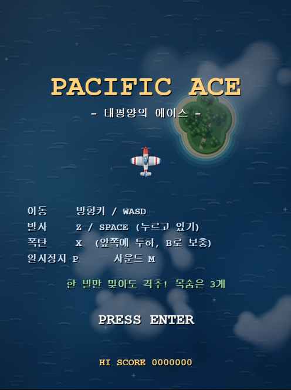
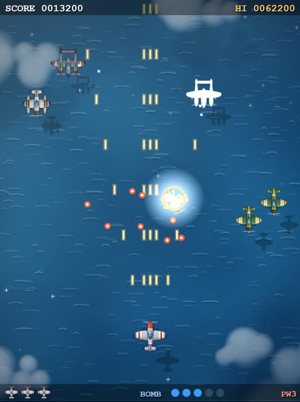
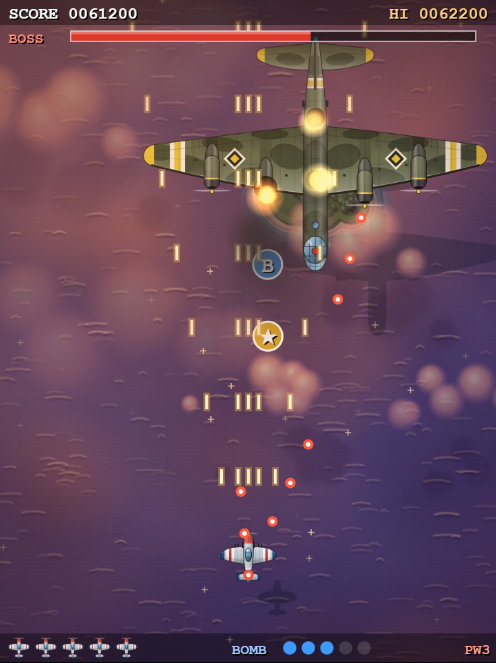

<div align="center">

```
╔══════════════════════════════════════════════════╗
║                                                  ║
║     ★  P A C I F I C   A C E  ★                  ║
║           - 태평양의 에이스 -                    ║
║                                                  ║
║            INSERT COIN  ▶  PRESS ENTER           ║
║                                                  ║
╚══════════════════════════════════════════════════╝
```

**1 PLAYER · 4 STAGES · 1 CREDIT**

### [▶ 지금 바로 출격하기](https://jihunyangai.github.io/pacific-ace/)

설치 없이 브라우저에서 바로 플레이할 수 있습니다. (키보드 필요)

  

</div>

---

## 📜 MISSION BRIEFING

> 조종사에게 알린다.
> 적 함대가 태평양 전역을 장악했다. 귀관의 임무는 단기로 적진을 돌파해
> 네 곳의 거점을 차례로 격파하는 것이다.
>
> 기체는 단 3대. 한 발만 맞아도 격추된다.
> 무운을 빈다.

오락실 시절의 종스크롤 비행 슈팅을 떠올리며 만든 오리지널 게임입니다.

## 🕹️ CONTROLS

| 키 | 동작 |
|---|---|
| `←` `↑` `↓` `→` / `W` `A` `S` `D` | 이동 |
| `Z` / `SPACE` (누르고 있기) | 기관총 발사 |
| `X` | 폭탄 투하 (앞쪽에 떨어져 대폭발) |
| `P` / `ESC` | 일시정지 |
| `M` | 사운드 켜기/끄기 |
| `ENTER` | 게임 시작 |

## ✈️ RULES

- **목숨 3개.** 탄이든 적기든 한 번 닿으면 격추됩니다.
- **폭탄 3발.** 투하하면 착탄 지점 주변의 적에게 큰 피해를 주고 적 탄을 모두 지웁니다. 떨어지는 동안은 무적입니다.
- **1UP.** 20,000점에 한 번, 이후 30,000점마다, 그리고 보스를 격파할 때마다 목숨이 늘어납니다. (최대 5개)
- **편대 전멸 보너스.** 3기 이상의 편대를 한 대도 놓치지 않고 격추하면 +500점과 아이템이 나옵니다.

### ITEMS

| 아이템 | 효과 |
|:---:|---|
| **P** | 무기 강화 (2연장 → 3연장 → 5방향). 격추되면 한 단계 내려갑니다. |
| **B** | 폭탄 +1 (최대 5발) |
| **★** | 훈장 +1,000점 |

## 🗺️ STAGES

| STAGE | 전장 | BOSS |
|:---:|---|---|
| **1** | 한낮의 바다 | **대형 전함** - 주포 4기를 부숴야 함교가 드러난다 |
| **2** | 노을 지는 바다 | **하늘 요새** - 엔진 4기를 멈춰야 조종석을 노릴 수 있다 |
| **3** | 폭풍우 치는 밤 | **항공모함** - 함재기를 끝없이 발진시킨다 |
| **4** | 얼어붙은 바다 | **해상 요새** - 회전하는 포탑이 탄막을 뿌린다 |

모든 보스는 주 무장을 전부 파괴해야 `CORE EXPOSED!`와 함께 약점이 열립니다.

## 👾 ENEMY FILE

| 기종 | 특징 |
|---|---|
| 녹색 전투기 | V자 편대로 일직선 하강 |
| 적색 전투기 | 뱀처럼 줄지어 굽이치며 하강 |
| 황색 전투기 | 측면 기습, 또는 플레이어를 향해 급강하 |
| 수상기 | 느리지만 맷집이 있고 여러 갈래 탄을 쏜다 |
| 전익기 | 화면 **아래**에서 치고 올라온다. `!!` 경고를 놓치지 말 것 |
| 로켓 요격기 | 탄은 쏘지 않고 고속으로 내리꽂는다 (STAGE 2~) |
| 쌍동 중전투기 | 2기가 좌우로 오가며 3갈래 탄 (STAGE 2~) |
| 폭격기 | 부채꼴 탄막. 격추하면 **P** 아이템 |
| **에이스기** | 플레이어를 쫓아다니며 3연사. 격추하면 아이템 |

## 🏆 RANK

4스테이지를 돌파하면 엔딩과 함께 최종 등급이 매겨집니다.
남은 기체 1대당 +5,000점, 남은 폭탄 1발당 +1,000점의 귀환 보너스가 더해집니다.

| RANK | 점수 | 칭호 |
|:---:|---:|---|
| **S** | 240,000 이상 | 전설의 에이스 |
| **A** | 210,000 이상 | 에이스 |
| **B** | 180,000 이상 | 베테랑 파일럿 |
| **C** | 그 미만 | 신참 파일럿 |

## 🔧 TECH SPEC

- **HTML5 Canvas + 순수 JavaScript.** 프레임워크와 빌드 과정이 없습니다.
- **외부 에셋 0개.** 기체·보스·배경은 전부 코드로 그리고, BGM과 효과음도 Web Audio로 합성합니다.
- 논리 해상도 240×320, 60fps 고정 스텝.

```
index.html
js/
 ├─ sprites.js     기체 스프라이트 (플레이어, 기본 적기, 폭격기)
 ├─ enemies.js     추가 적기 5종
 ├─ background.js  바다·섬·구름·날씨, 스테이지별 테마
 ├─ audio.js       효과음과 BGM 합성
 ├─ fx.js          폭발·불꽃·연기·잔해
 ├─ boss.js        보스 4종의 그림과 패턴
 └─ game.js        게임 진행, 입력, 충돌, HUD, 엔딩
```

### 내 컴퓨터에서 실행하기

```bash
git clone https://github.com/jihunyangAI/pacific-ace.git
```

받은 폴더의 `index.html`을 브라우저로 열면 됩니다.

---

<div align="center">

**GAME OVER?  —  CONTINUE ▶ [PRESS ENTER](https://jihunyangai.github.io/pacific-ace/)**

`© 2026 PACIFIC ACE` · Built with [Claude Code](https://claude.com/claude-code)

</div>
